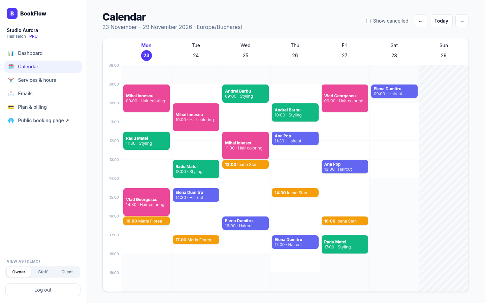
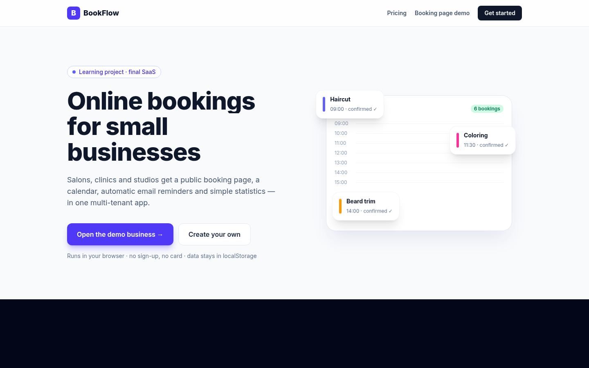
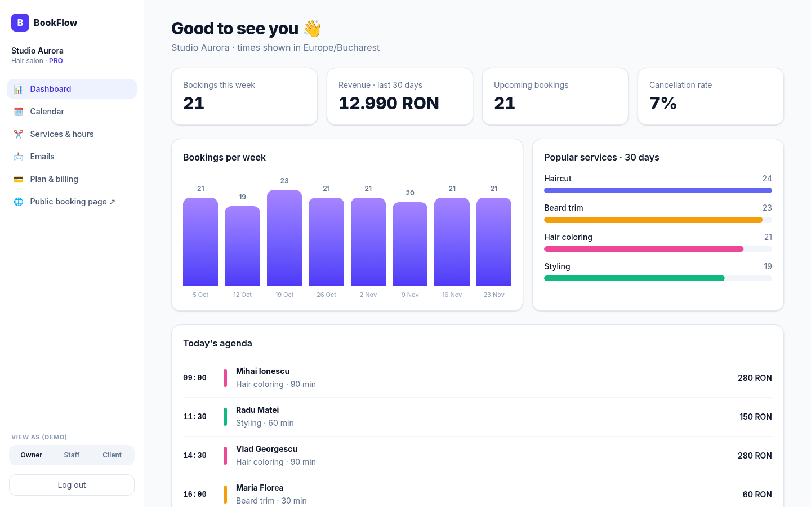
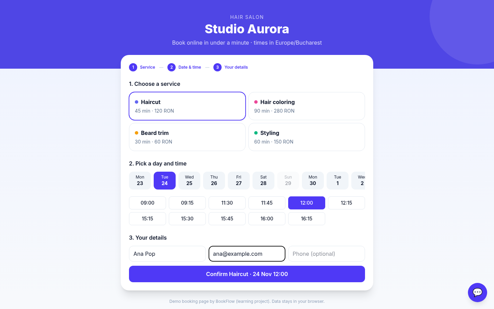
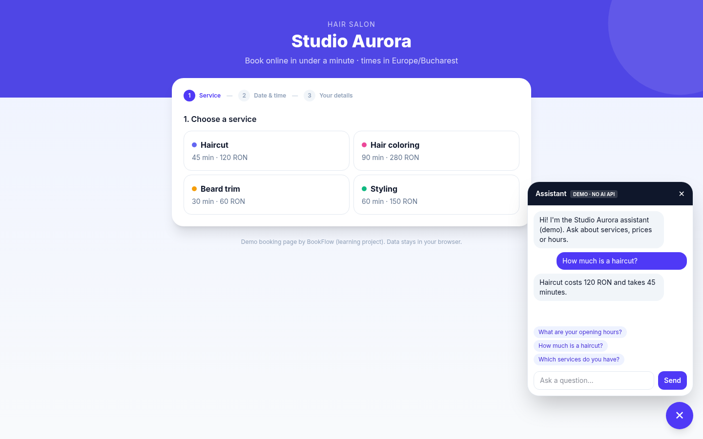
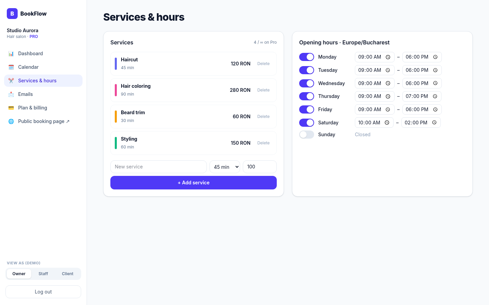
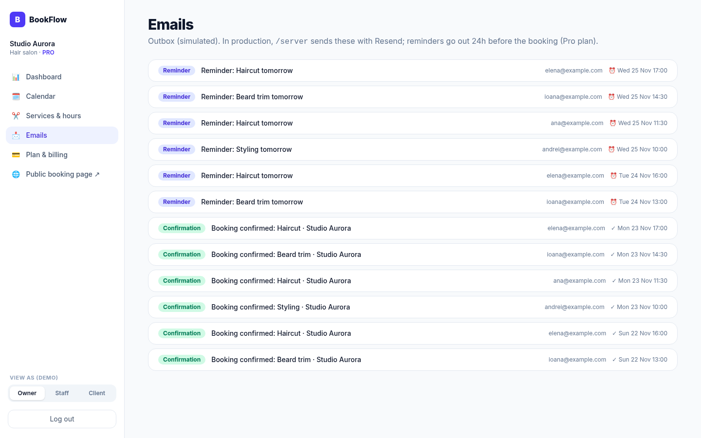
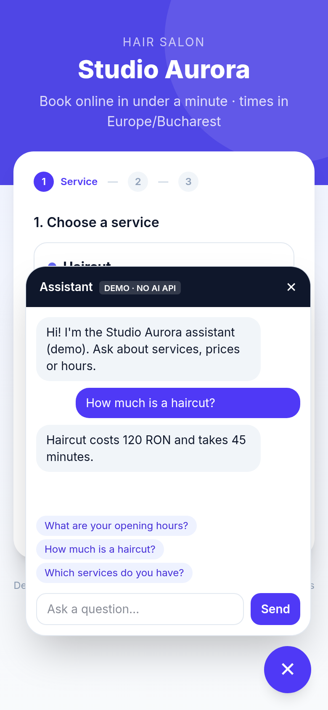

# BookFlow — booking SaaS for small businesses

A multi-tenant booking platform built with **Next.js 15**, **TypeScript**, **Tailwind CSS 4**, **Zustand**, **GSAP** and **Motion**, with an **Express** API in [`/server`](server/README.md).
Learning project #10 (the final project) from my portfolio plan — it combines the previous nine.

**Live demo:** https://davidgeorgeconstantin-spec.github.io/bookflow-saas/

> **How the live demo works:** GitHub Pages only hosts static files, so the demo keeps its "database" in your browser (localStorage). Click **Open the demo business** to load *Studio Aurora* — a fictional salon with seeded demo bookings — or create your own business. Payments are simulated (no card, no money), emails go to a simulated outbox, and the booking assistant is rule-based (no AI API). The `/server` folder shows the real backend: Express + Zod, Resend emails, Stripe test-mode webhooks and a Prisma/PostgreSQL schema.



## Features
- **Landing page** with GSAP animations: SplitText headline, parallax mock calendar, pinned "how it works" steps with scrubbed progress, horizontal feature rail, animated pricing toggle
- **Onboarding wizard** (3 steps, sliding transitions) → every business gets its own public booking page `/book/?b=<slug>`
- **Public booking page**: service → day → free slots → details → animated confirmation; slots are computed from opening hours, service length, existing bookings and a minimum notice; double booking is blocked
- **Time zones**: all times stored in UTC, calculated and shown in the business time zone (DST-safe, no date library)
- **Calendar** (week view): animated appointment blocks, "now" line, closed hours shaded, week navigation with slide transitions, shared-element booking details with cancel
- **Services & opening hours** editor (Free plan limit: 3 services)
- **Email outbox**: confirmation on booking, reminder 24h before (Pro), cancellation email
- **Dashboard** with statistics (from project 8): KPIs, bookings per week, popular services, today's agenda
- **Roles** owner / staff / client: staff can't see revenue, services, emails or billing
- **Plans Free / Pro** with a monthly / yearly toggle (simulated Stripe test-mode upgrade)
- **Assistant** on the booking page (idea from project 7) answering from the business data — demo mode, no AI API
- `prefers-reduced-motion` respected (GSAP `matchMedia` + Motion `reducedMotion="user"`)

## Multi-tenancy
Every record has a `businessId`. Components only read data through tenant-scoped selectors (`useTenant`), and the server takes the `businessId` from the session — never from the URL. A test checks that one business can't read or cancel another business's bookings.

## Tests
| | Command | What |
|---|---|---|
| Unit (Vitest) | `npm test` | time zones, slot generation, plan limits, emails, statistics — 11 tests |
| Server (Vitest + Supertest) | `cd server && npm test` | booking + 409 on a taken slot, validation, tenant isolation, roles, plan limit, Stripe signature — 5 tests |
| End-to-end (Playwright) | `npm run build && npm run test:e2e` | book an appointment → slot disappears → email in outbox; Free plan limit; staff blocked from billing — 3 tests |

## Stack
Next.js 15 (App Router, static export) · React 19 · TypeScript strict · Tailwind CSS 4 · Zustand 5 · GSAP 3 + ScrollTrigger + SplitText · Motion 12 · Vitest · Playwright · Express 5 · Zod · Prisma (schema) · Resend · Stripe (test mode) · GitHub Actions

## Structure
```
src/
├─ app/                    # routes: / · /signup · /book · /app (dashboard, calendar, services, emails, billing)
├─ components/layout/      # Providers, AppShell (sidebar, role guard, page transitions)
├─ components/ui/          # Card, Skeleton, AnimatedNumber
├─ features/
│  ├─ landing/             # Hero, HowItWorks, FeatureRail (GSAP)
│  ├─ onboarding/          # SignupWizard
│  ├─ booking/             # BookingFlow, AssistantWidget, SuccessCheck
│  ├─ calendar/            # WeekCalendar
│  ├─ services/            # ServicesManager (services + opening hours)
│  ├─ emails/              # Outbox
│  ├─ billing/             # PricingCards, BillingPage
│  ├─ dashboard/           # Dashboard
│  └─ tenancy/             # store (zustand + persist), seed, RoleSwitcher + permissions
├─ hooks/                  # useHydrated
├─ lib/                    # time, slots, plans, emails, stats, assistant (+ *.test.ts)
└─ types/
e2e/                       # Playwright tests + tiny static server
server/                    # Express API, Prisma schema, tests
```

## Run locally
```bash
npm install
npm run dev                # http://localhost:3000/bookflow-saas/
npm test                   # unit tests
cd server && npm install && npm run dev   # API on http://localhost:4000
```

## Deploy
- `.github/workflows/deploy.yml` → lint, unit tests, build, deploy to GitHub Pages (Settings → Pages → Source: **GitHub Actions**)
- `.github/workflows/e2e.yml` → Playwright tests on every push
- `.github/workflows/server-tests.yml` → server tests when `server/` changes

Free hosting options for the full version: the server on Render (free web service), PostgreSQL on Neon or Supabase (free tier), Resend free plan, Stripe test mode.

## Screenshots
| Landing | Dashboard |
|---|---|
|  |  |
| **Booking page** | **Assistant (demo)** |
|  |  |
| **Services & hours** | **Email outbox** |
|  |  |

Mobile:


